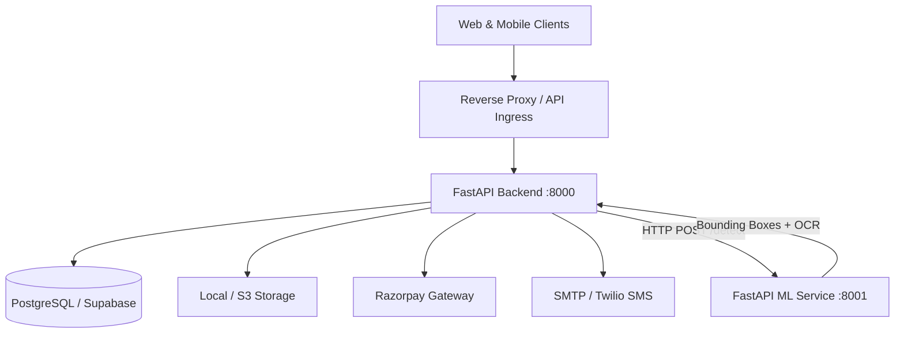
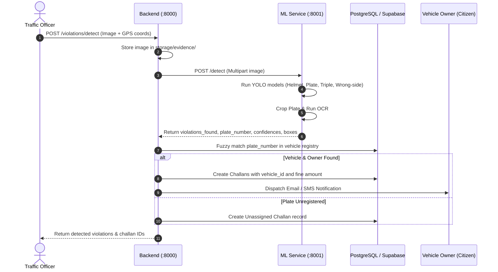

# Traffic E-Challan System Architecture

## High-Level Topology

The system is organized into a modular, decoupled microservice architecture:

---

## Component Roles & Responsibilities

### 1. `backend/` (Core Business & Challan Engine)
- **Role**: Primary API gateway for citizens, police officers, and administrators.
- **Responsibilities**:
  - User identity, JWT authentication, and OTP verification (`/auth`).
  - Vehicle registry lookup and fuzzy plate matching (`/vehicles`).
  - Challan issuance (automated AI detection and manual officer entries) (`/challans`).
  - Razorpay order creation, signature verification, and PDF receipt rendering with verification QR codes (`/payments`).
  - Violation catalog management (`/violations`).
  - Notifications dispatch (email & SMS simulated/SMTP).
  - High-level admin reporting metrics (`/admin`).

### 2. `ml-service/` (Computer Vision Inference Microservice)
- **Role**: Dedicated computer vision microservice running YOLO and OCR inference.
- **Responsibilities**:
  - General vehicle & rider object detection (`models/yolo11n.pt`).
  - Without Helmet violation classification (`models/helmet_best.pt`).
  - Wrong-Side driving classification (`models/wrong_side_best.pt`).
  - Triple-Riding violation detection (`models/triple_riding_best.pt`).
  - License plate localization (`models/numberplate_best.pt`).
  - Two-stage OCR enhancement (Grayscale equalization, adaptive binarization, and EasyOCR / FastPlateOCR recognition).
  - Single contract endpoint: `POST /detect`.

### 3. `frontend/` (Citizen & Admin Portal - Stub)
- **Role**: Single Page Application (SPA) client for end users.
- **Citizen Journey**: Mobile OTP login -> View unpaid/paid challans -> Pay via Razorpay -> Download verified receipt PDF.
- **Officer Journey**: Officer login -> Upload violation evidence image/video -> Review AI detected bounding boxes & plate -> Issue Challan.

### 4. `test-assets/` (Shared Test Media)
- Canonical repository for sample violation images, OCR test crops, and benchmark media shared across backend integration tests and ML debug scripts.

---

## AI Detection & Challan Workflow

